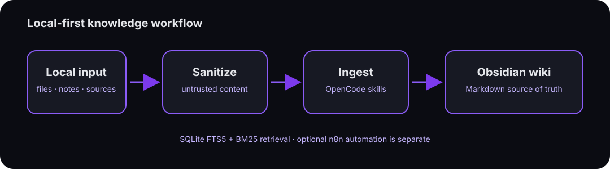

# opencode-obsidian (Bunker OS)

<p align="center">
  
</p>

<p align="center">
  <a href="LICENSE"></a>
  <a href="PROJECT.md"></a>
  <a href="Makefile"></a>
  <a href=".github/workflows/test.yml"></a>
  <a href="extensions/n8n"></a>
  <a href="https://opencode.ai"></a>
  <a href="https://obsidian.md"></a>
</p>

<p align="center">
  <b>Bunker OS</b> is a local-first personal knowledge workflow built around an Obsidian vault.<br>
  Capture information, sanitize and organize it, retrieve it later, and preserve context and decisions over time.<br>
  Agent tools and optional n8n automation support that core; they are not required to use it.
</p>

<p align="center">
  Based on the <a href="https://gist.github.com/karpathy/442a6bf555914893e9891c11519de94f">LLM Wiki pattern</a> by Andrej Karpathy · forked from <a href="https://github.com/AgriciDaniel/claude-obsidian">claude-obsidian</a>
</p>

<p align="center">
  
</p>

<br>

## Table of Contents

- [Why Bunker OS](#why-bunker-os)
- [Key Features](#key-features)
- [vs claude-obsidian](#vs-claude-obsidian)
- [Quick Start](#quick-start)
- [Commands](#commands)
- [Skills](#skills)
- [n8n Automation](#n8n-automation)
- [Architecture](#architecture)
- [BM25 Text Retrieval](#bm25-text-retrieval)
- [Testing](#testing)
- [Repository Structure](#repository-structure)
- [FAQ](#faq)
- [Requirements](#requirements)
- [Contributing](#contributing)
- [License](#license)

---

## Why Bunker OS

Bunker OS is for personal daily use: a practical way to turn sources, research, conversations, and decisions into durable local notes you can find and resume later. The Markdown vault is the source of truth. See the [product direction](docs/product-direction.md) for scope, principles, and priorities.

| Capability | Bunker OS | claude-obsidian | Smart Connections |
|---|:---:|:---:|:---:|
| Self-organizing wiki | Creates entities, concepts | ✅ | ❌ |
| n8n automation | Async + webhooks + DLQ | ❌ | ❌ |
| Autoresearch | 3-round web with gaps | ✅ | ❌ |
| Text retrieval | SQLite FTS5 + BM25 (incremental, zero deps) | BM25 + API | ❌ |
| Thinking framework | 10 principles | ✅ | ❌ |
| Test tooling | Separate core (Docker-independent) and optional extension checks | ✅ | ❌ |
| Dead Letter Queue | Global error handler | ❌ | ❌ |
| Evidence vault | SHA256 checksums | ❌ | ❌ |
| Multi-channel alerts | Optional n8n workflows; sender signs alerts | ❌ | ❌ |
| Health monitoring | Manual smoke workflow only; no service monitoring | ❌ | ❌ |
| Security & Guardrails | Ingestion sanitizer; alert signature is not validated by the reviewed alerter | ❌ | ❌ |
| Multi-methodology | ❌ (generic only) | LYT / PARA / Zettelkasten | ❌ |
| Multi-writer safe | ✅ (POSIX `fcntl.flock` + atomic rename) | Per-file locks | ❌ |
| Open source | MIT | MIT | Freemium |

> **Note on Smart Connections:** This column includes [Smart Connections](https://github.com/brianpetro/obsidian-smart-connections), an Obsidian community plugin that enables semantic search and RAG over vault notes. It is included for comparison as a complementary tool that works alongside Bunker OS. Bunker OS uses BM25 (keyword-based); Smart Connections uses vector embeddings (semantic). Both can run in the same vault.

> Bunker OS and claude-obsidian share an origin and can coexist in one vault. Bunker OS focuses on a local-first personal knowledge workflow, with agent tools and optional automation in support.

---

## Key Features

### 🧠 Knowledge

- **Persistent wiki** — 200+ pages of concepts, entities, sources, blueprints, and projects
- **Autoresearch** — 3-round autonomous web research: decomposes topics, searches, cross-references sources, and files everything into the wiki
- **SQLite FTS5 + BM25 search** — fast keyword and full-text search with incremental SHA-256 caching (`.vault-meta/fts5/vault_fts.db`), pure Python stdlib, zero external dependencies
- **`/think`** — 10-principle decision framework for architectural decisions and audits
- **Wiki-ingest** — source ingestion with automatic entity and concept extraction
- **Wiki-lint** — health check across 8 categories (orphans, dead links, missing frontmatter)

### ⚙️ Optional automation (n8n)

Automation is an extension, not a prerequisite for the personal knowledge workflow. Workflow status varies; some are inactive or experimental.

- **AOC v4** — documented pipeline concept using webhook, AI triage, GitHub, and notifications; not presented as a core knowledge capability
- **Dead Letter Queue** — workflow for collecting errors when enabled
- **Health Check** — manual smoke workflow that returns a static status; it does not monitor services or run periodically
- **Ultimate Alerter** — multi-channel alerts; the sender generates HMAC-SHA256 signatures, but the reviewed alerter does not validate them
- **Emergency Reprocessor** — auto-retry of failed events every 5 min

### 🛡️ Operations & Security

Host and repository utilities are optional implementations in `extensions/operations/`; legacy `bin/` entry points remain compatibility shims. See [extension guidance](extensions/operations/README.md) and the [security boundaries](docs/security-boundaries.md).

- **Multi-writer concurrency** — POSIX advisory locking (`fcntl.flock`) and atomic file replacement (`scripts/vault_lock.py`, `bin/vault-lock.sh`)
- **Source handling** — best-effort heuristic sanitizer (`scripts/sanitize_ingest.py`) for selected invisible characters, known override text, and HTML patterns; sanitized content remains untrusted
- **Webhook alert signing** — `bin/bunker-alert.sh` generates an HMAC-SHA256 signature; the reviewed alerter does not validate it
- **Test tooling** — `make test-core` checks knowledge workflows without Docker; `make test-extensions` validates optional n8n assets, and `make test` runs both
- **Evidence vault** — `report.zip` and `security-audit-report.json` indexed with SHA256
- **Integrity engine** — automated vault health scripts with Markdown + JSON reports
- **Command Center** — dashboard + agent queue + handovers + governance
- **OpenCode hooks** — `SessionStart` (reads `hot.md`), `PostCompact` (reloads after compaction), `Stop` (auto-updates `hot.md`)
- **13 OpenCode skills** ready to use

---

## vs claude-obsidian

| Dimension | Bunker OS | claude-obsidian |
|---|---|---|
| Version | v1.4.0 | v1.9.2 |
| Purpose | Local-first personal knowledge workflow; optional agent and automation tools | PKM / second brain |
| Harness | OpenCode | Claude Code (plugin) |
| Language | English | English |
| Skills | 13 operational | 15 research |
| Async automation | n8n on Docker | None |
| Text retrieval | SQLite FTS5 + BM25 (incremental, stdlib) | BM25 + API + rerank |
| Test tooling | Core and extension checks are distinct; CI runs `make test` | ~1,240 (9 suites) |
| Evidence checksums | ✅ | ❌ |
| Dead Letter Queue | ✅ | ❌ |
| Multi-channel alerts | Optional workflows; sender-generated HMAC is not validated by reviewed alerter | ❌ |
| Security sanitization | Pre-ingest anti-injection | ❌ |
| Multi-methodology | ❌ | LYT / PARA / Zettelkasten |
| Multi-writer safe | ✅ (`fcntl.flock` + atomic rename) | ✅ |
| Plugin marketplace | ❌ | Claude Code plugin |
| Stars | — | 8.5k |

---

## Quick Start

### Option 1 — Clone as vault (recommended)

```bash
git clone https://github.com/Haiagari/opencode-obsidian.git
cd opencode-obsidian
```

Open the folder in **Obsidian**: *Manage Vaults → Open folder as vault → select `opencode-obsidian/`*.

Open **OpenCode** in the same folder, then start with `autoresearch` or `ingest [file]`.

### Option 2 — Reference from another project

Add to your `AGENTS.md`:

```markdown
## Wiki Knowledge Base
Path: /path/to/opencode-obsidian

When you need context:
1. Read wiki/hot.md first (recent context)
2. If not enough, read wiki/index.md
3. Only then read individual wiki pages
```

---

## Commands

### OpenCode Skills

| Command | Action |
|---|---|
| `autoresearch [topic]` | 3-round autonomous web research. Decomposes, searches, files |
| `retrieve [query]` | BM25 text search over wiki (no LLM needed for indexing) |
| `think [problem]` | 10-principle decision framework |
| `ingest [file]` | Ingest source: extract entities and concepts, create pages |
| `ingest all of these` | Batch ingestion with parallel processing |
| `what do you know about X` | Query the wiki: hot → index → pages → synthesize |
| `lint the wiki` | Health check: orphans, dead links, gaps |
| `save this` | Save current conversation as a wiki note |
| `wiki [setup/scaffold]` | Set up vault structure or create new knowledge base |
| `defuddle https://...` | Clean web page before ingesting; remove ads/boilerplate |
| `canvas` | Open or create visual canvas |
| `canvas add image [path]` | Add image to canvas |
| `index evidence` | Index audit artifacts (report.zip, JSON) with SHA256 checksums |
| `obsidian bases` | Create/edit Obsidian Bases (.base) database views |

#### CLI Scripts

```bash
make test-core                         # Core checks; no Docker or n8n configuration
make test-extensions                   # Optional n8n workflow/config validation
make test                              # Core + extension validation
./bin/bunker-check.sh                  # Local definition of done
./bin/wiki-integrity.sh                # Scan for orphans and broken links
./bin/evidence-index.sh                # Index evidence with SHA256
./bin/vault-lock.sh append wiki/log.md # Concurrency-safe atomic append
./bin/bunker-alert.sh target info "msg" # Optional n8n alert; sender signature is not validated by reviewed alerter
./bin/bunker.sh init                   # Vault health check
./bin/wiki-sync.sh --apply             # Sync + commit wiki
python3 scripts/fts_engine.py index    # SQLite FTS5 incremental indexation
python3 scripts/fts_engine.py "query"  # SQLite FTS5 + BM25 ranked search
python3 scripts/sanitize_ingest.py doc # Pre-ingest prompt injection check
python3 scripts/retrieve.py "query"    # Legacy BM25 text retrieval
```

### `autoresearch` — research support for the knowledge workflow

Configurable at `skills/autoresearch/references/program.md`:

- Max rounds: 3
- Max pages per session: 15
- Source preference (academic, official, news)
- Confidence scoring (high/medium/low)
- Domain-specific rules

**Research flow:**
1. Round 1 — Broad search: Decompose into 3-5 angles, 2-3 queries each via Exa
2. Round 2 — Gap fill: Targeted searches for contradictions & gaps
3. Round 3 — Synthesis: One more pass if gaps remain
4. File to wiki

URL validation + content sanitization: rejects `file://` / `javascript://` / RFC1918, escapes `[[` in external sources, truncates to 50KB.

### `think` — 10-principle decision framework

```bash
think <problem statement>
```

Walks through 10 stages:

`OBSERVE (external)` → `OBSERVE (internal)` → `LISTEN` → `THINK` → `CONNECT (lateral)` → `CONNECT (system)` → `FEEL` → `ACCEPT` → `CREATE` → `GROW`

Use for non-trivial architectural decisions, audits, and post-mortems.

---

## Skills

*13 bundled in this repo + 6 provided by the ECC global config*

### Bundled in this repo

| Skill | Description |
|---|---|
| `autoresearch` | 3-round web research with Exa + webfetch |
| `wiki-retrieve` | BM25 & SQLite FTS5 text retrieval (stdlib Python, zero deps) |
| `think` | 10-principle decision framework |
| `wiki-ingest` | Ingest sources into the wiki |
| `wiki-query` | Query the wiki with synthesis |
| `wiki-lint` | Vault health check |
| `save` | Save conversation as wiki note |
| `wiki` | Wiki orchestrator (setup, scaffold, routing) |
| `canvas` | Obsidian canvas visual layer |
| `defuddle` | Web extraction wrapper |
| `evidence-index` | Evidence indexing with SHA256 |
| `obsidian-bases` | Obsidian Bases schema reference |
| `obsidian-markdown` | Obsidian Flavored Markdown reference |

### Provided by ECC global config

Not bundled in the repo, but available when the ECC skill bundle is installed.

*Note: ECC = Enterprise Cloud Config (or Enterprise Command Center). Define this in AGENTS.md or docs.*

| Skill | Description |
|---|---|
| `code-review` | Code quality review |
| `security-review` | OWASP security review |
| `infra-design` | Infrastructure design |
| `tdd-workflow` | TDD with red-green-refactor |
| `verification-loop` | Build + test + lint + security pre-PR |
| `work-unit-commits` | Commits organized by work unit |

---

## Optional n8n Automation

n8n is an optional extension for asynchronous workflows; the vault and local knowledge tools do not depend on it. Workflow activation and maturity vary, so check the workflow table before relying on a flow. This is not a claim of enterprise readiness or complete security.

### Available Workflows

| Workflow | Nodes | Status | Description |
|---|:---:|---|---|
| Health Check | 2 | 🟢 Active | Manual trigger; returns static status, no periodic monitoring |
| Ultimate Alerter | 2 | ⚪ Inactive | Multi-channel webhook; receiver does not validate sender signatures |
| Dead Letter Queue | 5 | ⚪ Inactive | Error trigger: captures workflow errors when configured |
| AOC v4 Enterprise | 37 | ⚪ Inactive | Experimental prototype; no receiver authentication or source rate limiting |

### AOC v4 Enterprise Pipeline

The workflow export contains prototype nodes for webhook intake, triage, routing, and notifications. Its inactive state is intentional: the asset has no receiver authentication or source-based rate limiting, and static JSON validation does not establish that external services are configured or operational. Do not activate or expose it until the missing controls are implemented and tested.

### Dead Letter Queue

**Flow:**

- Global Error Trigger captures errors from any workflow
- Normalizes error context
- Classifies severity: CRITICAL (auth, timeout, permissions) vs WARNING
- Stores in `staticData` (last 200 errors)
- Triggers notifications on CRITICAL

Catches errors from **any** workflow in the instance. Persists the last 200 errors for review and audit.

### Infrastructure

Configure optional n8n environment variables in `extensions/n8n/.env`:

```yaml
N8N_CONCURRENCY_PRODUCTION_LIMIT=20   # High concurrency limit tuned for production
EXECUTIONS_DATA_PRUNE=true            # Auto cleanup
EXECUTIONS_DATA_MAX_AGE=168           # Keep execution data for 7 days
EXECUTIONS_DATA_PRUNE_MAX_COUNT=50000 # Max pruned execution entries
N8N_METRICS=true                      # Observability
N8N_LOG_FORMAT=json                   # Structured logs
```

Environment: PostgreSQL recommended, queue mode with Redis for horizontal scaling.

---

## Architecture

### Vault flow



New raw inputs and source notes are ignored by Git by default. Previously tracked source files remain public in the repository history; see [AGENTS.md](AGENTS.md#vault) before placing private content in the vault.

### Async automation & Security

```
OpenCode (skills) / Local CLI
  ├→ bin/bunker-alert.sh (generates HMAC-SHA256 header; receiver validation is not implemented in reviewed alerter)
  └→ n8n Docker (localhost:5678)
       ├→ Webhooks → AOC pipeline → GitHub Issues
       ├→ Manual run → Health Check (static status only)
       ├→ Schedule → Emergency Reprocessor (5 min)
       └→ Error Trigger → Dead Letter Queue
            ↓
         Notifications (Slack / Telegram / Discord)
```

---

## BM25 & SQLite FTS5 Text Retrieval

The Bunker includes a fast, zero-dependency text retrieval engine using SQLite FTS5 with native BM25 ranking (`-bm25(wiki_fts)`). No embeddings, no LLM calls, and zero external dependencies (pure Python standard library: `sqlite3`, `hashlib`).

OpenCode (the agent) receives the ranked chunks and applies its own model to understand and synthesize the answer. **The agent is the only intelligence in the loop.**

**Retrieval flow:**
```
Query
  ↓
SQLite FTS5 (`.vault-meta/fts5/vault_fts.db`) with BM25 Ranking
  ↓
Top K results (ranked by relevance)
  ↓
OpenCode reads & synthesizes
```

### Key Architectural Characteristics

- **Zero External Dependencies**: Built entirely on Python stdlib `sqlite3` with `PRAGMA journal_mode = WAL`.
- **Incremental Indexing**: Uses file modification times (`mtime`) and SHA-256 content hashes to only re-index modified or added notes.
- **Multilingual Tokenizer**: Uses `unicode61 remove_diacritics 2` for full-text search across English and Spanish.
- **High Performance**: Sub-millisecond keyword and BM25 ranking across thousands of chunks.

### Maintenance

```bash
# Build/update SQLite FTS5 incremental index
python3 scripts/fts_engine.py index

# Check status of index & tracked files
python3 scripts/fts_engine.py status

# Query via SQLite FTS5 engine
python3 scripts/fts_engine.py "n8n docker automation" --top 5
```

---

## Testing

### Suites

| Suite | Tests | What it validates |
|---|:---:|---|
| `test-core` | Core | Wiki integrity, shell checks, retrieval, unit tests; no Docker/n8n `.env` required |
| `test-extensions` | Optional | n8n workflow JSON and compose YAML validation; does not start Docker |
| `test` | Both | Runs core and optional extension validation |

### CI

The GitHub Actions workflow runs `make test` on pushes and pull requests to `main`.

```bash
make test-core        # Core checks without Docker/n8n configuration
make test-extensions  # Optional extension static checks
make test             # Run both core and extension checks
```

### Secrets scanned

The test suite automatically checks for:

- OpenAI keys (`sk-...`)
- GitHub PAT (`ghp_...`, `gho_...`)
- AWS keys (`AKIA...`)
- Google API keys (`AIza...`)
- Slack tokens (`xox[baprs]-...`)

See [SECURITY.md](SECURITY.md) for the full security policy.

---

## Repository Structure

```
opencode-obsidian/
├── skills/                       13 repo skills + 6 ECC global
│   ├── autoresearch/             3-round autonomous research
│   ├── wiki-retrieve/            BM25 & FTS5 text retrieval
│   ├── think/                    10-principle framework
│   ├── wiki-ingest/              Source ingestion
│   ├── wiki-query/               Wiki querying
│   ├── wiki-lint/                Vault health check
│   ├── save/                     Save conversation
│   ├── wiki/                     Wiki orchestrator
│   ├── canvas/                   Visual canvas
│   ├── defuddle/                 Web extraction
│   ├── evidence-index/           Evidence indexing
│   ├── obsidian-bases/           Bases schema
│   └── obsidian-markdown/        OFM reference
├── agents/                       3 OpenCode agents
├── commands/                     Slash commands
├── hooks/
│   └── hooks.json                7 hooks across 4 events
├── scripts/                      Python + bash helpers
│   ├── fts_engine.py             SQLite FTS5 + BM25 incremental search engine
│   ├── vault_lock.py             POSIX advisory locking (`fcntl.flock`) & atomic ops
│   ├── sanitize_ingest.py        Pre-ingest prompt injection & payload sanitizer
│   ├── bm25-index.py             BM25 indexer
│   └── retrieve.py               Search orchestrator
├── tests/                        Core + optional extension checks
│   ├── test_workflow_connections.py
│   ├── test_wiki_integrity.sh
│   ├── test_scripts.sh
│   ├── test_fts_engine.py
│   ├── test_vault_lock.py
│   └── test_sanitize_ingest.py
├── Makefile                      Test targets & root runner
├── bin/                          Core commands + compatibility shims
│   ├── bunker-check.sh           Full health check
│   ├── vault-lock.sh             CLI wrapper for atomic lock & write
│   ├── bunker-alert.sh           Optional n8n alert compatibility entry point
│   ├── wiki-integrity.sh         Integrity scan
│   └── evidence-index.sh         Evidence indexing
├── extensions/
│   ├── n8n/                      Optional n8n/AOC workflows, setup, and alert implementation
│   └── operations/               Optional host/repository tools; legacy bin/ shims remain
├── wiki/                         Obsidian vault (200+ pages)
│   ├── hot.md                    Recent context
│   ├── index.md                  Master catalog
│   ├── log.md                    Operation log
│   ├── sources/                  External sources
│   ├── entities/                 People, orgs, products
│   ├── concepts/                 Concepts and patterns
│   ├── meta/                     Dashboard, handovers, evidence
│   └── blueprints/               Architecture blueprints
├── .raw/                         Immutable source documents
├── .github/workflows/test.yml    CI: runs on push/PR
├── README.md                     This file
├── PROJECT.md                    Technical documentation
├── WIKI.md                       Wiki schema reference
├── BUNKER_RULES.md               Governance rules
├── AGENTS.md                     Agent instructions
├── CONTRIBUTING.md               Contribution guide
├── SECURITY.md                   Security policy
└── CHANGELOG.md                  Version history
```

---

## FAQ

<details>
<summary><b>What's the difference between Bunker OS and claude-obsidian?</b></summary><br>

Both projects share a common origin. Bunker OS focuses on a local-first personal knowledge workflow: capture, organize, retrieve, and preserve context in an Obsidian vault. Its scripts, agent skills, and optional n8n workflows support that core. Use the vault without n8n; automation maturity varies.

</details>

<details>
<summary><b>Can I use Bunker OS without OpenCode?</b></summary><br>

Technically yes (scripts are bash and Python, tests are Makefile, n8n is Docker), but the real value is in the OpenCode skills. Without OpenCode you lose autoresearch, think, wiki-ingest, and wiki-query.

</details>

<details>
<summary><b>Where is data stored?</b></summary><br>

The vault is a folder of Markdown files on your disk. Optional n8n can run locally with Docker. External tools or user-configured sync may involve other services; this project does not guarantee that every workflow or integration keeps all data local.

</details>

<details>
<summary><b>How do I sync across devices?</b></summary><br>

The vault is a plain folder of files. Use Obsidian Sync, Syncthing, iCloud, Dropbox, or git.

</details>

<details>
<summary><b>How do I add a source to the wiki?</b></summary><br>

Drop the file in `.raw/` and say `ingest [filename]`. New files in `.raw/` and `wiki/sources/` are ignored by Git, but a few files in those folders are already tracked in public history. Check `git ls-files .raw wiki/sources` before putting private material there.

</details>

<details>
<summary><b>What is the Dead Letter Queue?</b></summary><br>

A global workflow that catches errors from any other n8n workflow. Classifies severity and persists to `staticData` for later review.

</details>

<details>
<summary><b>Can I activate the AOC v4 Enterprise?</b></summary><br>

Not safely in its current state. The workflow is an inactive prototype and does not authenticate webhook callers or limit request rates. Keep it inactive and do not expose it to a network until those controls are implemented and tested.

</details>

<details>
<summary><b>How do I rebuild the BM25 index after adding pages?</b></summary><br>

```bash
python3 scripts/retrieve.py build
```

</details>

<details>
<summary><b>Where are the tests?</b></summary><br>

```bash
make test    # 430 tests
```

</details>

---

## Requirements

| Component | Minimum | Notes |
|---|---|---|
| OpenCode | latest | https://opencode.ai |
| Obsidian | v1.6+ | Any modern version |
| Python | 3.10+ | For BM25 index + retrieve |
| Bash | 4.0+ | For operational scripts |
| Docker | latest | For n8n |
| Git | any | For vault versioning |

**Optional:**

- **ollama** — for local inference via OpenCode if configured
- **n8n** on Docker — for workflow automation
- **OpenRouter API key** — for AI triage in AOC v4

---

## Contributing

PRs welcome. Read first:

- [`PROJECT.md`](PROJECT.md) — technical documentation
- [`BUNKER_RULES.md`](BUNKER_RULES.md) — governance and standards
- [`CHANGELOG.md`](CHANGELOG.md) — version history

```bash
make test    # Run tests before pushing
```

---

## License

MIT License. See [LICENSE](LICENSE) for full text.

---

<p align="center">
  Based on the <a href="https://gist.github.com/karpathy/442a6bf555914893e9891c11519de94f">LLM Wiki pattern</a> by Andrej Karpathy.
  <br>
  Built by <a href="https://github.com/Haiagari">Haiagari</a> for <a href="https://opencode.ai">OpenCode</a>.
  <br>
  <i>Compounding knowledge is the highest-leverage habit a thinking person can build.</i>
</p>
