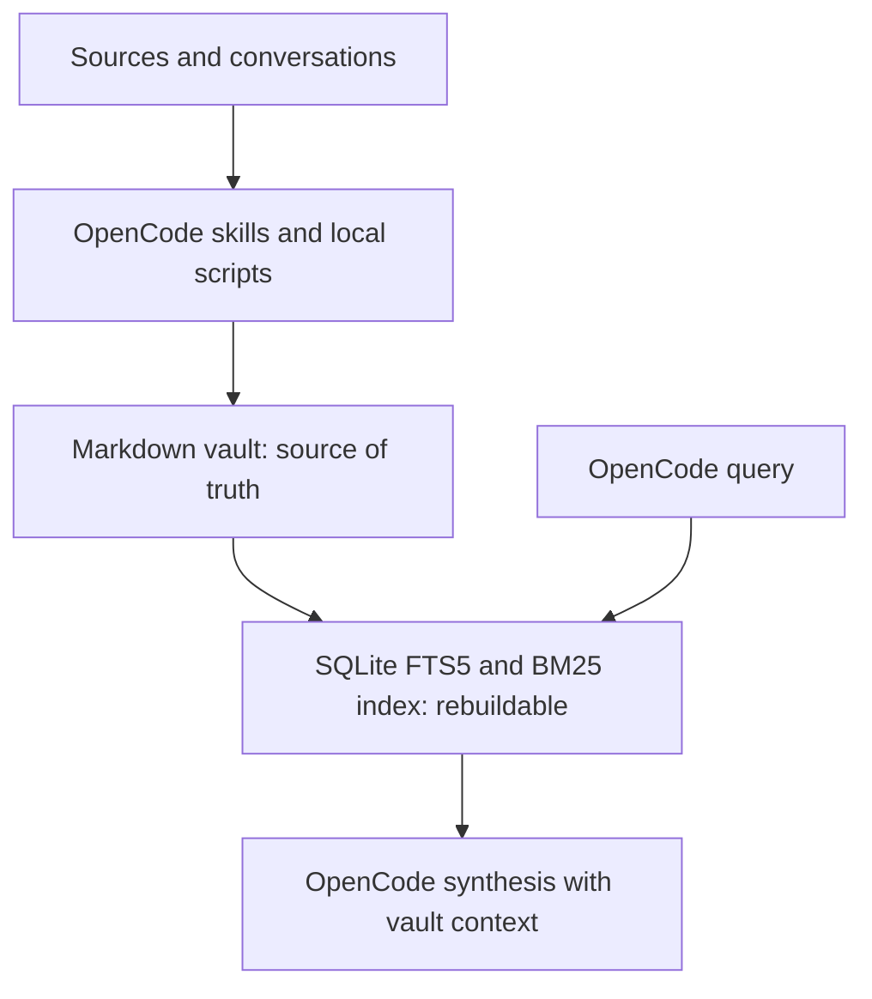

# Architecture

Bunker OS is a local-first workflow around an Obsidian vault. Markdown files are the source of truth. Search indexes, scripts, the optional HTTP inbox, and n8n support the workflow without becoming prerequisites for the vault.

## Core data flow

The database is derived from Markdown and can be rebuilt. Query synthesis happens in OpenCode after local retrieval; the index itself does not call an LLM.

## Capture paths

| Path | What it does | Where review happens |
|---|---|---|
| `wiki-ingest` skill | Processes a source and creates or updates relevant wiki pages | The agent treats the source as untrusted and follows the ingest procedure |
| Go local ingest API | Stores a short note in `wiki/inbox/`; it does not interpret or file it | A person or agent must review and file the note |
| n8n workflows | Optional asynchronous automation, independent from core vault operation | Workflow-specific; webhook prototypes remain inactive |

The sanitizer is a limited text heuristic. It does not prove that a source is safe. Treat both original and sanitized content as untrusted.

## Component boundaries

| Component | Role | Source of truth? |
|---|---|---:|
| Obsidian Markdown vault | Durable notes, wiki links, and context | Yes |
| OpenCode skills and scripts | Capture, organize, query, and maintain notes | No |
| SQLite FTS5/BM25 | Rebuildable local retrieval index | No |
| Go ingest API | Authenticated loopback capture to a review inbox | No |
| n8n extension | Optional external-service automation | No |

## Optional n8n boundary

n8n is separate from the local knowledge core. The Compose service binds to host loopback by default. AOC and alert webhook workflows remain inactive because their receiver-side authentication and abuse controls are incomplete. The manual Health Check returns static status; it does not monitor service health. See [n8n setup](N8N-SETUP.md) and [security boundaries](security-boundaries.md).

## Related references

- [Using Bunker OS](usage-guide.md) — practical workflows and commands
- [Local Ingest API](local-ingest-api.md) — request contract and limits
- [Security boundaries](security-boundaries.md) — threat model and current safeguards
- [Architecture note in the vault](../wiki/concepts/opencode-obsidian-architecture.md) — Obsidian knowledge-base context
